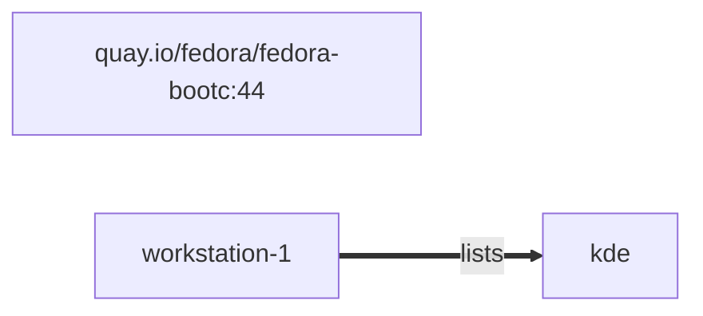

# Creating a bootc image

A bootc image is a container image that a machine boots and updates from, rather than a container that runs as a process. This tutorial teaches how a buildc repository and its schema work by building two workstation images from the same requirements: fedora-bootc 44 as the base, the KDE Plasma desktop, the Firefox browser, and Flatpak with one Flatpak app, Bazaar, a Flatpak app store.

The tutorial starts from what you already know from a Containerfile: a script that runs in the build and a file tree copied into the image. It then adds the schema features that describe the same work declaratively. `workstation-1` is written by hand. Its one component of its own is a shell script and a file tree, exactly as a Containerfile would do it. `workstation-2` builds the same desktop from a component library and the buildc commands instead. The library components it uses add package installs that know which family they are installing for, and dependencies that buildc checks before you build. The last part of the tutorial builds `workstation-1` locally and sets up CI that publishes a signed image.

This is a thorough introduction and not the fastest route to a working repository. `buildc create repo` scaffolds a ready repository with defaults in one command. This page instead adds one line at a time so you see what each line does.

> [!NOTE]
> Run this tutorial somewhere disposable. It creates signing keys and reads the `buildc` library.

## Create the repository

Create a directory, put it under Git, and create the starting files:

```sh
mkdir buildc-tutorial
cd buildc-tutorial
buildc create git
mkdir components
touch repo.kdl workstation-1.kdl
```

`buildc create git` runs `git init` and writes a `.gitignore` that ignores `keys/private/`, `out/` and `.cache/`. It refuses a directory that is already inside a Git repository, because a repository does not nest.

You now have:

```text
buildc-tutorial/
├── .gitignore
├── components/
├── repo.kdl
└── workstation-1.kdl
```

`repo.kdl` holds the repository settings: the schema version, the name, the builds, the libraries it reads, where images publish, and the CI workflows. `workstation-1.kdl` is an image file. An image file is a component file at the repository root, and a build in `repo.kdl` names it. `components/` holds the components you write yourself. A component is a directory under `components/`.

The [repository layout](https://buildc-org.github.io/buildc/schema/repository/) page has the full layout, including files this tutorial does not touch.

## Write repo.kdl

Write this into `repo.kdl`:

<!-- kdl-file: repo.kdl -->
```kdl
schema-version 1
name "Buildc Tutorial"

builds {
    workstation-1 "./workstation-1"
}
```

`schema-version` is the one required line. `name` is the repository name. Commands derive ids from it, such as the name of the repository's own library later on. `builds` lists the images the repository builds. Each entry is a build name and the component file it reads, so `"./workstation-1"` reads `workstation-1.kdl` at the repository root. A build name is the published image name, the build target and the cache tag. It takes lowercase letters, digits and dashes, and it starts with a letter.

Every node `repo.kdl` takes is on the [repo.kdl](https://buildc-org.github.io/buildc/schema/repo/) page.

## Write the image file

Write this into `workstation-1.kdl`:

<!-- kdl-file: workstation-1.kdl -->
```kdl
schema-version 1

base-image {
    base "quay.io/fedora/fedora-bootc:44" {
        family "fedora"
    }
}
```

Each node in an image file names a component by its path, one path segment per node. A segment that holds component properties defines that component inline, so it needs no directory. Here `base-image` is a component defined inline. Its `base` makes it the base: it names the bootc image reference the build starts from. `family` tells components which package manager and package names the base has. An image holds one base, and every layer builds on it.

The image's display name is not a field of the image. The `os-release` component's `name` option sets it. The component writes the name into `/usr/lib/os-release`, where the boot menu and the desktop read it. An image that does not list `os-release`, or lists it without `name`, keeps the name its base image ships. When an image lists `os-release`, its `default-hostname` option defaults to the build name.

An option value can read two values that buildc supplies: `{image-id}` is the build name, and `{base-url}` is the repository URL that `repo.kdl` declares as `base-url`. `buildc generate` writes the value in place of the reference, so the generated files hold the text itself. For example, an `os-release` block could use them like this:

<!-- kdl-fragment -->
```kdl
os-release {
    name "Workstation"
    home-url "{base-url}"
    bug-report-url "{base-url}/issues"
}
```

If `repo.kdl` declares no `base-url`, `buildc check` refuses a value that reads `{base-url}` and tells you to declare `base-url "https://host/owner/repository"` in `repo.kdl`. `buildc create repo` writes `base-url` when you give it an owner. In a repository written by hand, as here, you add the line yourself if you need it.

A doubled brace writes a literal brace. A dollar sign is not a reference. An empty `os-release` option writes no line, and the base's value stays.

Every node an image file takes is on the [component schema](https://buildc-org.github.io/buildc/schema/component/) page.

## Write a component by hand

Create a directory for the `kde` component:

```sh
mkdir components/kde
```

Write this into `components/kde/component.sh`:

```sh
dnf5 install -y plasma-desktop
```

It installs KDE Plasma with the Fedora base's package manager. `buildc generate` gives `component.sh` its own `RUN` layer in the generated Containerfile.

Create a file tree for the component:

```sh
mkdir -p components/kde/files/etc/skel/.config
```

Write this into `components/kde/files/etc/skel/.config/kdeglobals`:

```ini
[General]
ColorScheme=BreezeDark
```

Everything under a component's `files/` directory is copied into the image at the same path, so this file lands at `/etc/skel/.config/kdeglobals`. The generated Containerfile copies the tree from `generated/<build>/components/kde/files/`.

Now list `kde` in `workstation-1.kdl`:

<!-- kdl-file: workstation-1.kdl -->
```kdl
schema-version 1

base-image {
    base "quay.io/fedora/fedora-bootc:44" {
        family "fedora"
    }
}
kde
```

An image lists a component by its path under `components/`, one segment per node. `components/dev/git` and `components/dev/brew` would be listed as a `dev` block holding `git` and `brew`, with `dev` then a directory that holds components rather than a component itself.

Run the check:

```sh
buildc check
```

```text
buildc: 1 images, 2 components
```

The image checks with one image and two components: the base and `kde`. `kde` needs no manifest. A script and a file tree are enough to make a component.

Every file and directory a component can use is on the [component directory layouts](https://buildc-org.github.io/buildc/schema/components/) page.

## Declare a library

A library is a Git repository of base components and feature components. A base component in a library holds the facts about a base image: what it ships, the components every image on it needs, its family and its bootloader. The default `buildc` library holds base components for Fedora, CentOS Stream, RHEL, AlmaLinux, Rocky Linux, Debian, Ubuntu and the Universal Blue images under `base-image/`, and feature components for many other uses.

Run:

```sh
buildc set library buildc
```

A name on its own adds that default library and asks nothing. Without an argument, a terminal offers the default libraries and another location. `--source` declares a library at an HTTPS Git URL or a path.

`repo.kdl` now reads:

<!-- kdl-file: repo.kdl -->
```kdl
schema-version 1
name "Buildc Tutorial"

builds {
    workstation-1 "./workstation-1"
}

libraries default="local-library" {
    local {
        local-library { source "." }
    }
    remote {
        buildc { source "https://github.com/buildc-org/library" }
    }
}
```

The `remote` entry is the `buildc` library. The `local` entry `local-library` names this repository's own components as a library too. A path that only one library holds reads that library, so `kde` still reads `components/kde`. When several libraries hold a path, it reads the library of the file that lists it. If that library does not hold the path, `default=` names the library it reads instead.

## Create an image with the CLI

Run:

```sh
buildc create image workstation-2 --base base-image/fedora-bootc
```

`--base` names the library's `base-image/fedora-bootc` base component and skips the base picker. Without arguments, `buildc create image` asks for the image name and the base.

The command writes the new `workstation-2.kdl` at the repository root:

<!-- kdl-file: workstation-2.kdl -->
```kdl
schema-version 1

base-image {
    fedora-bootc signed=#false {
        version "44"
    }
}
os-release {
    name "workstation-2"
}
```

It also adds the build to `repo.kdl`:

<!-- kdl-fragment -->
```kdl
builds default="workstation-1" {
    workstation-1 "./workstation-1"
    workstation-2 "./workstation-2" {
        install {
            bootloader "grub2"
        }
    }
}
```

Nothing is copied into the repository. The image file lists each library component by its path, and the build reads it straight from the library. The base lists one bootloader, `grub2`, so the command asked no bootloader question and wrote it into the build's `install` block directly. A base with several bootloaders would ask one. The base lists no `os-release` of its own, so the command offered the library's `os-release` and set its `name` option to the image name. Without a terminal it takes that offer automatically. The repository now has two builds, so the command set `default="workstation-1"` on `builds`. A bare `buildc build` still builds what it built before.

`version "44"` sets the `version` option of the base component. `signed=#false` records that the base publishes no signature. A separate base signature probe workflow corrects this later.

This is the library's base component, `base-image/fedora-bootc`, shortened where the comment says:

<!-- kdl-fragment -->
```kdl
provides {
    "rechunking"
    "luks-initramfs"
    "initramfs-generation" witness="/usr/bin/dracut"
    "selinux-policy" witness="/usr/sbin/semodule"
    "ssh" witness="/usr/sbin/sshd"
    "package-manager/dnf5" witness="/usr/bin/dnf5" package="dnf5"
    // and the rest of what the base image ships
}

component "/" {
    fedora {
        build-environment
    }
}

base "quay.io/fedora/fedora-bootc:{version}" {
    family "fedora"
    bootloader "grub2"
    scap-content "ssg-fedora-ds.xml" {
        pin {
            renovate datasource="github-releases" depName="ComplianceAsCode/content" extractVersion="^v(?<version>.+)$"
            version "0.1.82"
            url "https://github.com/ComplianceAsCode/content/releases/download/v{version}/scap-security-guide-{version}.zip"
            sha256 "190a74c09b648db49a5805087a914659b49346cfde974858d3465ade5fc66c7e" from="manual"
        }
    }
}

option "version" type="string" {
    default "44"
}
```

`base` makes it a base, and its block states the family, the bootloader and the benchmark content. `provides` lists capabilities that the base image already ships, one per line, so components that need them are satisfied. A short list can go on one line, such as `provides "rechunking" "luks-initramfs"`. A `witness` names a path that proves the capability is there. The build checks the finished image for it. The `component "/"` block lists components from the library root that every image on this base builds. Here the base brings `fedora/build-environment`, so `workstation-2.kdl` does not need to list it itself. `scap-content` names the benchmark content that remediates the image and that a compliance scan reads. Its `pin` says where `buildc generate` fetches the file and the hash it must match.

Run the check again:

```sh
buildc check
```

```text
buildc: `workstation-2` reads `base-image/fedora-bootc` from `buildc` at e0fc5a08b980, which repo.lock.kdl does not record; `buildc generate` records it
buildc: `workstation-2` reads `fedora/build-environment` from `buildc` at e0fc5a08b980, which repo.lock.kdl does not record; `buildc generate` records it
buildc: `workstation-2` reads `os-release` from `buildc` at e0fc5a08b980, which repo.lock.kdl does not record; `buildc generate` records it
buildc: 2 images, 5 components
```

The commit in your own output will differ from the one above. Each library component is read at a commit. `repo.lock.kdl` records the commit and the content hash of each library component a build reads. Until `buildc generate` writes the lock, `buildc check` reports each component the lock does not yet record.

The lock file format is on the [repo.lock.kdl](https://buildc-org.github.io/buildc/schema/repo-lock/) page.

## Create a component with the CLI

Run:

```sh
buildc create component browser --build workstation-2
```

`--build workstation-2` lists the new component in that build's image file. Without arguments, `buildc create component` asks for the name, an optional description, optional base families and the builds that list it.

The component gets a `manifest.kdl` with no packages. `buildc create component` asks nothing about packages itself.

Add the package:

```sh
buildc add package firefox --component browser
```

`components/browser/manifest.kdl` now reads:

<!-- kdl-file: components/browser/manifest.kdl -->
```kdl
schema-version 1

packages "firefox"
```

`buildc add package` writes only the names the component does not already list, so it is safe to repeat. Without `--component`, a terminal asks for the group name and offers a picker of the components the repository holds. A path the repository does not hold writes a new component instead. With `--no-tui`, neither command prompts. `buildc create component <name>` then writes the component with no description and lists it in no build. `buildc add package` without `--component` fails and names that flag.

The [CLI reference](cli.md) lists every argument of both commands.

## Declare a dependency

A missing dependency is expensive to find during the image build or at runtime. `provides` and `requires` in a manifest let buildc find it before the build files even exist.

Firefox is a graphical app, so add `requires "graphical-session"` to the browser's manifest:

<!-- kdl-file: components/browser/manifest.kdl -->
```kdl
schema-version 1

packages "firefox"

requires "graphical-session"
```

Run `buildc check` again:

```text
  × `browser` requires `graphical-session`, which nothing enabled provides
   ╭─[./components/browser/manifest.kdl:5:10]
 4 │ 
 5 │ requires "graphical-session"
   ·          ─────────┬─────────
   ·                   ╰── unsatisfied
   ╰────
  help: no component in the repository declares `provides "graphical-
        session"`, and neither does the base `base-image/fedora-bootc`.
        `buildc add component` lists what the declared libraries provide

buildc: 1 problem in ./components/browser/manifest.kdl; none in ./repo.kdl, ./workstation-1.kdl, ./workstation-2.kdl
buildc: `workstation-2` reads `base-image/fedora-bootc` from `buildc` at e0fc5a08b980, which repo.lock.kdl does not record; `buildc generate` records it
buildc: `workstation-2` reads `fedora/build-environment` from `buildc` at e0fc5a08b980, which repo.lock.kdl does not record; `buildc generate` records it
buildc: `workstation-2` reads `os-release` from `buildc` at e0fc5a08b980, which repo.lock.kdl does not record; `buildc generate` records it
```

Nothing in `workstation-2` provides `graphical-session` yet. The help text names `buildc add component`, which lists what the declared libraries provide. Nothing adds a component to an image on its own. The check only names the gap, and you choose the provider.

## Add components from a library

Run:

```sh
buildc add component desktop-environment/kde-plasma --in workstation-2
```

This adds the library's `desktop-environment/kde-plasma` to `workstation-2`. `buildc add component` copies nothing. The image file references the component, and the build reads it from the library. In a terminal, with no arguments, the command asks which component takes the reference, which components to add, and whether to add the providers they require. A component that a chosen build cannot use names that build after `does not support`.

`workstation-2.kdl` now reads:

<!-- kdl-file: workstation-2.kdl -->
```kdl
schema-version 1

base-image {
    fedora-bootc signed=#false {
        version "44"
    }
}
os-release {
    name "workstation-2"
}
browser

desktop-environment {
    kde-plasma
}
```

Run `buildc check` again. It passes, because KDE Plasma provides `graphical-session`. `desktop-environment/kde-plasma` itself requires `build-environment`, and the base already brings `fedora/build-environment`.

This is part of the library manifest of `desktop-environment/kde-plasma`:

<!-- kdl-fragment -->
```kdl
targets "fedora" "debian" "ubuntu"

provides {
    "graphical-session"
    "wayland"
    "plasma-desktop" witness="/usr/bin/plasmashell"
}

provides "display-manager" exclusive=#true

requires "build-environment"

packages {
    "plasma-desktop"
    "plasma-workspace"
    "dolphin"
    "konsole"
    "kate"
    // and the rest of the Plasma application set
}

on "fedora" {
    packages "plasma-login-manager" "kcm-plasmalogin" "kwin" "kscreenlocker"
}
```

`targets` restricts a component to the base families it lists. `provides` and `requires` name capabilities that a component supplies or needs: a graphical app requires `graphical-session`, and a desktop provides it. `exclusive=#true` means a second provider conflicts. `buildc check` refuses a build that would hold two display managers. `packages` installs through the base's package manager, which the `build-environment` component supplies for each family. A short list goes on one line, and a long one goes in a block with one name per line. Each `packages` node installs as one batch. `on "fedora"` gates the declarations inside it to the named families, so one component can handle the differences between families itself.

The manifest is opt-in. `workstation-1`'s `kde` builds without one, and its author owns its compatibility with the base.

## Extend buildc with a component

A component can also add to the `buildc` tool itself and to the generation step.

**Key hook.** A component's `key` node makes `buildc create key` generate a key pair for it. The public half is installed in the image where the component says. `buildc create key` writes the private half under `keys/private/` and prints the command that stores it as a GitHub secret.

Run:

```sh
buildc add component updates/signature-policy --in workstation-2
```

This verifies image updates with cosign. Its `key` node reads:

<!-- kdl-fragment -->
```kdl
key "cosign" {
    generator "cosign"
    public "/etc/pki/containers/cosign.pub"
    private "cosign.key"
}
```

`generator` is one of `cosign`, `openssl` or `ssh-keygen`. Run:

<!-- transcript-command: buildc create key cosign -->
```sh
buildc create key cosign
```

<!-- transcript-output: buildc create key cosign -->
```bash
Private key written to cosign.key
Public key written to cosign.pub
wrote keys/public/etc/pki/containers/cosign.pub
wrote keys/private/cosign.key

the key carries no password, which is what the build workflow decrypts it with.

next:
  commit keys/public/etc/pki/containers/cosign.pub
  gh secret set SIGNING_SECRET < keys/private/cosign.key
```

The `.gitignore` from `buildc create git` already ignores `keys/private/`. `buildc create key` warns when nothing ignores the private half. `buildc check` refuses a component whose key has no public half yet, and its help says to run `buildc create key`.

**Collection.** A component can gather one named file from every component in the image. Run:

```sh
buildc add component flatpak apps/bazaar --in workstation-2
```

This adds Flatpak and Bazaar. Part of the Flatpak manifest reads:

<!-- kdl-fragment -->
```kdl
collects "flatpaks.list" into="/usr/share/flatpak-defaults/apps.list" priority=500

provides "flatpak" witness="/usr/bin/flatpak"
```

It collects every `flatpaks.list` into one list in the image. Bazaar's own `flatpaks.list` holds:

```text
io.github.kolunmi.Bazaar
```

Bazaar's manifest requires `flatpak` and `graphical-session`.

**Helpers.** A component's `helpers` node shares files with every other component's layer. `fedora/build-environment` shares `lib/family.sh`, which installs packages with the right command for the family.

## Check and generate

Run:

```sh
buildc check
buildc generate
```

`buildc check` names what is missing at the line that caused it. `buildc generate` writes `generated/`. Each build gets `generated/<build>/` with its `Containerfile`, its component scripts under `components/`, `finalize.sh` and the capability graph `graph.md`. `generated/plan.json` records the resolved plan, and `generated/lib/` and `generated/scripts/` hold shared helpers and scripts.

`buildc generate` also writes `repo.lock.kdl`. It moves each library component to the library's current version and records its commit and content hash. Every other command then reads each library component at the commit the lock records. Commit the lock.

Run:

<!-- transcript-command: buildc graph -->
```sh
buildc graph
```

<!-- transcript-output: buildc graph -->
````markdown
# `workstation-1` capability graph

GENERATED FILE, do not edit.

An arrow points from a provider to what needs it, dotted for `after`,
which orders the build without requiring anything. Layers build left to
right.
A thick arrow points from a component to what it lists or imports.



## Imports

| Component | By | How |
|---|---|---|
| `kde` | `workstation-1` | lists |
````

This is the capability graph of the default build, `workstation-1`. The image file is a component too, so the graph shows `workstation-1` listing `kde`.

Run:

<!-- transcript-command: buildc summary -->
```sh
buildc summary
```

<!-- transcript-output: buildc summary -->
```markdown
2 components.

| Component | Description | Options | Satisfies | Refuses |
| --- | --- | --- | --- | --- |
| `kde` |  |  |  |  |
| `workstation-1` |  |  |  |  |
```

This lists what the default build is made of. Run:

<!-- transcript-command: buildc why browser -->
```sh
buildc why browser
```

<!-- transcript-output: buildc why browser -->
```markdown
# browser

## Where it is built

workstation-2

## What it exchanges

| Direction | What | With |
| --- | --- | --- |
| requires | `graphical-session` | desktop-environment/kde-plasma |

## What it declares to install

| Family | Packages | Enabled repository |
| --- | --- | --- |
| `fedora` | `firefox` | default |

## What it claims

Nothing. It declares no `satisfies`.

## Where it came from

| Content | Hash |
| --- | --- |
| declared | `d402c6c8e5d8b2946930e88be8de074e183fd0dd7bee5022c03d87fd1c72cd5b` |

It was written in this repository, so no library holds a version to compare it against.

## What it pulls in

Nothing. It declares no `asset`.

## Third-party repositories

None. It declares no `copr` and ships no `repo.sh` file.
```

This shows where the browser is built, what it exchanges with other components, what it installs and where it came from. `buildc why` on a library component instead says which library it is read from.

## Copy a component to edit it

A library component is read in place, so you cannot edit it inside the repository as it stands. Run:

```sh
buildc copy component buildc/desktop-environment/kde-plasma
```

`buildc copy component` copies the component into `components/` and records the library source it came from, the commit and the content hash in `components/origins.kdl`. The copy is the repository's own, and you may edit it freely.

The image file still lists `desktop-environment/kde-plasma`. Two libraries hold that path now, and `workstation-2.kdl` belongs to this repository's own library, so the path reads the copy. `buildc why` on the copy says where it came from and whether it has been edited since. An edit is reported plainly and is not an error.

The origins file format is on the [origins.kdl](https://buildc-org.github.io/buildc/schema/origins/) page.

## Build the image

Run:

<!-- transcript-command: buildc build -->
```sh
buildc build
```

`buildc build` checks that the generated files are current, then builds the default build. `buildc build workstation-2` builds the other one. The image builds on the host with `buildah` and lands in the local Podman store. One line of its output names the tag it builds:

<!-- transcript-output: buildc build -->
```text
buildc: tags workstation-1:latest
```

An image publishes under a registry namespace. `IMAGE_REGISTRY` sets it for one command, and `registry "ghcr.io/<owner>"` in `repo.kdl` sets it for the whole repository. Run:

<!-- transcript-command: IMAGE_REGISTRY=ghcr.io/example buildc registry ref -->
```sh
IMAGE_REGISTRY=ghcr.io/example buildc registry ref
```

<!-- transcript-output: IMAGE_REGISTRY=ghcr.io/example buildc registry ref -->
```text
ghcr.io/example/workstation-1:latest
```

This is the reference the default build publishes under.

## Publish with CI

Run:

```sh
buildc set workflows image-build
buildc generate
```

`buildc set workflows` chooses the GitHub Actions workflows and writes them into `repo.kdl`:

<!-- kdl-fragment -->
```kdl
github {
    workflows {
        image-build
    }
}
```

`buildc generate` then writes `.github/workflows/image-build.yml`. In a terminal without a workflow name, `buildc set workflows` offers every workflow, and a workflow the repository cannot run shows its reason.

Pushed to GitHub, `image-build` builds each image, generates its SBOM (software bill of materials), pushes it to the registry, signs it with cosign using the key in the `SIGNING_SECRET` secret, and attests the SBOM. A build whose image declares `conforms` is also scanned against its benchmark profile. This tutorial declares no `conforms`, so its images skip that scan.

The `update-components` workflow runs `buildc generate` on a schedule. It opens a pull request that moves `repo.lock.kdl` to the libraries' new commits, so each library update is reviewed before it builds.

The `github` block is documented on the [repo.kdl workflows](schema/repo.md#github) page.
